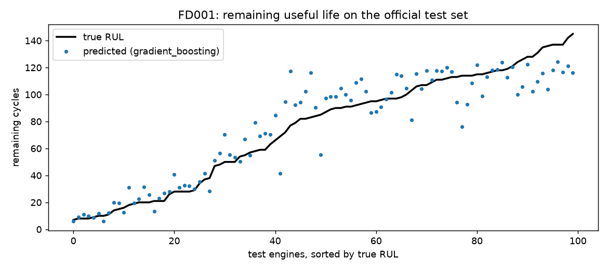
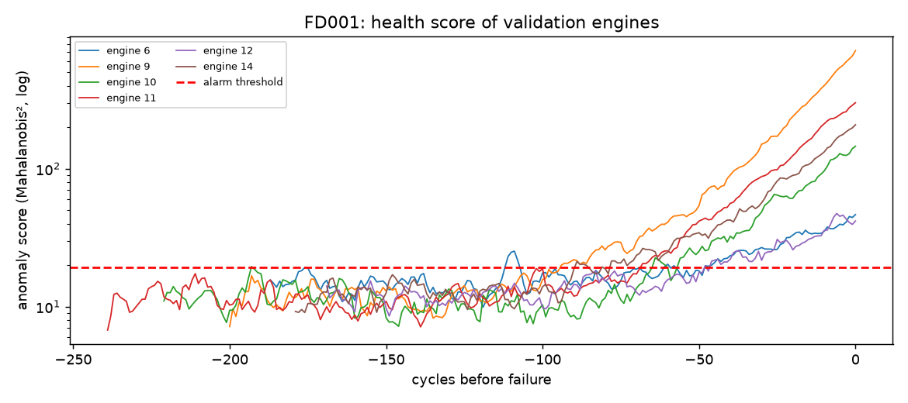
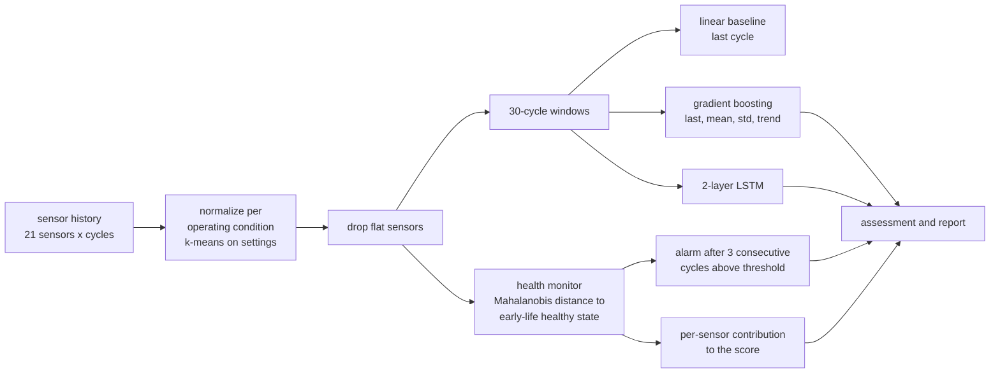

# Turbofan predictive maintenance: remaining life, anomaly detection and sensor-level diagnosis

[](https://github.com/ihebtb/turbofan-predictive-maintenance/actions/workflows/ci.yml)


Given the sensor history of an aircraft engine, this project answers three questions an
operator asks:

1. **How many flights are left before failure?** Remaining useful life (RUL) regression,
   comparing a linear baseline, gradient boosting and an LSTM.
2. **Is the engine still healthy?** An unsupervised health monitor that learns the healthy
   state from early-life data only and raises an alarm when the engine drifts away from it.
3. **What is going wrong?** For every alarm, the sensors that explain the deviation, with their
   physical names (core speed, HPC outlet temperature, ...), in a short investigation report.

Data: [NASA C-MAPSS](https://phm-datasets.s3.amazonaws.com/NASA/6.+Turbofan+Engine+Degradation+Simulation+Data+Set.zip)
turbofan run-to-failure simulations (Saxena et al., PHM 2008): 4 subsets, 21 sensors,
1 or 6 operating conditions, 1 or 2 fault modes.

## Results

Official NASA test sets (last cycle of each test engine), RUL capped at 125. Lower is better
for both metrics; the PHM08 score penalizes late predictions more than early ones.

| Subset | Conditions / faults | Linear (RMSE / score) | Gradient boosting | LSTM |
|---|---|---|---|---|
| FD001 | 1 / 1 | 21.73 / 1060 | **14.02 / 298** | 15.52 / 380 |
| FD002 | 6 / 1 | 32.76 / 20435 | 27.01 / 8924 | **26.55 / 7944** |
| FD003 | 1 / 2 | 22.11 / 1659 | **14.80 / 352** | 16.61 / 826 |
| FD004 | 6 / 2 | 34.25 / 12431 | 27.63 / 5564 | **27.54 / 5215** |

Health monitor on held-out run-to-failure engines (no failure label used to fit it), and on
sensor faults injected into healthy cycles:

| Subset | Engines alarmed before failure | Median lead time | Alarm in healthy phase | Injected faults: recall / false positive rate |
|---|---|---|---|---|
| FD001 | 100% (20) | 72.5 cycles | 0% | 1.00 / 0.5% |
| FD002 | 100% (52) | 46 cycles | 1.9% | 0.37 / 0.5% |
| FD003 | 60% (20) | 53.5 cycles | 0% | 1.00 / 0.5% |
| FD004 | 100% (49) | 50 cycles | 2.0% | 0.55 / 0.5% |

What the numbers say:

- On single-condition data (FD001, FD003) gradient boosting on window statistics beats the
  LSTM; both are far ahead of the linear baseline.
- The six-condition subsets (FD002, FD004) remain the hard part: validation RMSE is about 15
  but test RMSE is about 27, so the gap comes from the short, truncated test histories under
  mixed conditions. Published deep models reach roughly 16-20 here; closing that gap is the
  next step (longer windows, condition-aware features).
- On FD003, 40% of engines fail through a fault mode the health score reacts to late, so the
  alarm misses them; the RUL models still see it.
- Abrupt sensor faults are easy to catch under one condition and harder under six, where
  normal variation between flight conditions is larger.




Figures for all four subsets are in `reports/figures/`, raw numbers in `reports/results.json`.

## How it works



- **Operating conditions.** FD002 and FD004 mix six flight conditions; a healthy engine reads
  very differently in each. The three setting columns are clustered (k-means, k=6) and sensors
  are standardized within each condition, otherwise the models learn the flight condition
  instead of the wear.
- **Target.** RUL is capped at 125 cycles (piecewise-linear target): early in life the engine
  is healthy and the exact distance to failure is not observable.
- **Validation.** 20% of the training engines are held out by engine (never by row) for early
  stopping and for calibrating the alarm threshold. Test numbers use NASA's official test sets.
- **Health monitor.** Fitted on the first 30 cycles of every training engine (all engines start
  healthy), with a Ledoit-Wolf covariance. The alarm threshold is the 99.5th percentile of the
  score on the early cycles of the *validation* engines. No failure label is used.
- **Diagnosis.** The squared Mahalanobis score splits exactly into one term per sensor
  (`z_i * (P z)_i`), so the report can say which sensors drive an alarm and in which direction.

## Quick start

```bash
git clone https://github.com/ihebtb/turbofan-predictive-maintenance.git
cd turbofan-predictive-maintenance
python -m venv .venv && source .venv/bin/activate
pip install -e ".[dev]"

python scripts/download_data.py          # NASA C-MAPSS, about 12 MB
python -m turbofan.train                 # FD001 + FD003 (add --subsets FD002 FD004 for all four)
python -m turbofan.report --subset FD001 --unit 24
uvicorn turbofan.api:app                 # http://localhost:8000/docs
```

Trained models for the four subsets are included in `models/`, so the API and the report work
without retraining.

### Example investigation report

For test engine 24 of FD001 (`python -m turbofan.report --subset FD001 --unit 24`):

```
Engine assessment (FD001, 186 cycles observed)
- Estimated remaining useful life: 24.7 cycles (gradient boosting 25.6, LSTM 23.7)
- Health score 210.45 vs threshold 19.19: ALARM, first raised at cycle 121
- Score trend over the last 10 cycles: rising (+8.058 per cycle)
- Sensors explaining the current deviation:
    Nc (Physical core speed): above healthy range, z = 11.29, 45% of the score
    NRc (Corrected core speed): above healthy range, z = 9.69, 39% of the score
    phi (Ratio of fuel flow to Ps30): below healthy range, z = -2.5, 5% of the score
- True remaining life (official label): 20 cycles
```

### API

`POST /assess` with an engine's cycles returns the RUL estimate (each model and their mean),
the health score and threshold, the alarm state and first alarm cycle, the top contributing
sensors and the text report. `GET /health` for liveness.

```bash
docker build -t turbofan . && docker run -p 8000:8000 turbofan
```

## Tests

```bash
pytest        # 12 tests on synthetic degrading engines; no dataset download
ruff check .
```

The tests build a small synthetic fleet whose sensors drift exponentially before failure, then
check the RUL labels, engine-level splitting, normalization, windowing, both metrics, that
every model beats a constant predictor, that the health monitor alarms before failure and not
during the healthy phase, that the explanation points at the degrading sensors, fault
injection, model serialization, the assessment service and the API.

## Project layout

```
src/turbofan/
  data.py         loading, RUL labels, engine-level split, sensor names
  preprocess.py   per-operating-condition normalization, flat-sensor removal
  windows.py      sliding windows and window statistics
  models.py       linear baseline, gradient boosting, LSTM
  anomaly.py      health monitor, alarms, per-sensor explanations, fault injection
  metrics.py      RMSE and the PHM08 score
  train.py        training, evaluation, figures, reports/results.json
  service.py      engine assessment and investigation report
  api.py          FastAPI service
  report.py       CLI report for a test engine
```

## Limits

- C-MAPSS is simulated data with clean fault progressions; real fleet data has missing
  values, sensor replacements and maintenance events that this pipeline does not handle.
- The alarm threshold assumes the first 30 cycles of every engine are healthy, which holds in
  C-MAPSS by construction but must be checked on real data.
- Fault-injection results measure detection of abrupt sensor faults on healthy cycles; slow
  degradation is measured separately by the lead time before failure.

## Author

**Iheb Tebai**, final-year Data Engineering student (AI & Machine Learning), 
[LinkedIn](https://www.linkedin.com/in/iheb-tebai-475717370) · [GitHub](https://github.com/ihebtb)
